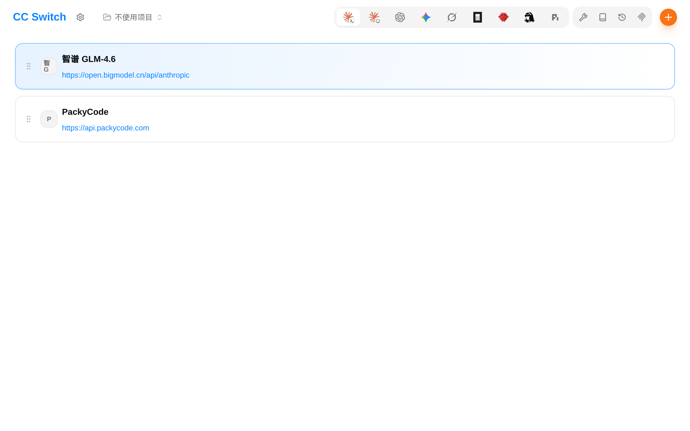
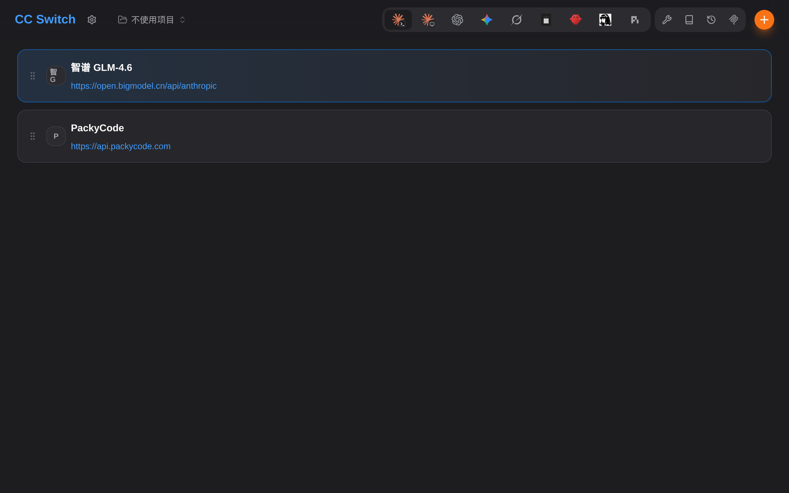

<div align="center">
  
  <h1>fn-ccswitch</h1>
  <p>把 CC Switch 的 Web 版打包成飞牛 fnOS 应用，在桌面窗口里直接切换 AI 工具的供应商配置</p>
</div>

<div align="center">

[](https://github.com/Maluslock/fn-ccswitch/releases)
[](LICENSE)


</div>

## 项目简介

[CC Switch](https://github.com/cp-yu/cc-switch-web) 是管理 Claude Code / Codex / Gemini / OpenCode 等
AI 编程工具供应商配置的切换器。它的上游形态是 Tauri 桌面程序，而飞牛桌面只能以窗口（iframe）
或新标签页承载 Web 应用，所以桌面版无法直接安装。

本项目把社区维护的 **Web 版 cc-switch-web** 适配成 fnOS Native 应用：

- 服务端二进制只监听 `127.0.0.1`，通过飞牛**统一网关**暴露到桌面，不额外对外开端口；
- 前端在构建期重新打包，把 API 基址改成网关前缀 `/app/fn-ccswitch/api`；
- 生命周期脚本、向导、图标、依赖全部按 fnOS 应用规范组织，可直接 `fnpack build` 出 `.fpk`。

## 核心能力

- 在飞牛桌面窗口里一键切换 Claude Code / Codex / Gemini 的供应商配置
- 通过统一网关访问：复用 NAS 登录态，浏览器侧不暴露任何新端口
- 应用自管配置：所有数据落在应用自己的目录，互不干扰，卸载即清理
- 托管 MCP 服务器、提示词、技能（Skills）、会话记录与配置导入导出
- 支持浅色 / 深色主题，中文 / 英文 / 日文 / 繁体中文界面
- 生命周期完整：安装向导、升级保留数据、卸载可选清空数据

## 界面截图

| 供应商列表 | 深色主题 |
| --- | --- |
|  |  |

## 它是怎么跑起来的

```
浏览器（飞牛桌面里的应用窗口）
        │  https://<你的 NAS>:5667/app/fn-ccswitch/
        ▼
fnOS 统一网关（校验 NAS 登录态，注入 X-Trim-Userid / X-Trim-Username）
        │  Unix Socket：${TRIM_APPDEST}/app.sock
        ▼
gateway-proxy.mjs ──静态资源──▶ ${TRIM_APPDEST}/web（本项目重新构建的前端）
        │  /api/*、/api/ws
        ▼
127.0.0.1:17666  cc-switch-web（上游二进制，只监听回环）
```

关键约束与对策：

| 约束 | 对策 |
| --- | --- |
| 桌面是 HTTPS，iframe 里直接引 `http://host:port` 会被混合内容拦截 | 走统一网关，应用只监听 Unix Socket |
| 上游前端把 API 基址写死成 `/api` | 构建期用 `VITE_CC_SWITCH_API_BASE` 注入 `/app/fn-ccswitch/api` |
| 前端用相对路径引资源，`/app/fn-ccswitch` 无尾斜杠会 404 | 构建期 `vite --base=/app/fn-ccswitch/` |
| 上游二进制依赖 `libssl.so.1.1`（Ubuntu 20.04 构建） | 构建时从 Debian 归档解出两个 `.so` 随包携带 |
| 应用以包用户身份运行，够不到 NAS 用户家目录 | 配置归属应用自己（`HOME=${TRIM_PKGHOME}`） |
| 上游没有 arm64 产物 | `manifest` 里 `platform=x86` |

## 快速开始

### 环境要求

- 飞牛 fnOS `1.1.3100` 及以上，`x86_64`
- 依赖应用 `nodejs_v24`（安装时由应用中心自动安装）

### 安装

1. 从 [Releases](https://github.com/Maluslock/fn-ccswitch/releases) 下载 `fn-ccswitch.fpk`；
2. 飞牛「应用中心 → 手动安装」，选择该 fpk；
3. 向导里填一个**仅本机使用**的内部端口（默认 `17666`，保持默认即可）；
4. 装完在桌面点图标打开，窗口内直接使用。

> `17666` 只监听 `127.0.0.1`，浏览器访问一律走 `/app/fn-ccswitch`。

### 从源码构建

```bash
# 需要：node >= 22、pnpm 10、fnpack
./scripts/build.sh

# 产物：dist/fn-ccswitch.fpk
```

构建脚本会：下载上游对应版本的 Linux 二进制 → 解包 Debian 的 `libssl1.1` 共享库 →
拉取上游源码 → 应用 `patches/` 里的补丁 → 重建前端并校验注入结果 → 组装 → `fnpack build`。

### 测试

```bash
./scripts/test.sh
```

- `tests/gateway.test.mjs`：16 项网关代理测试（前缀剥离、静态资源、Cookie 收窄、WebSocket 升级等）
- `tests/lifecycle.sh`：22 项生命周期测试（安装 / 启动 / 停止 / 改端口 / 升级 / 卸载清理）

## 目录结构

```
pkg/                     fpk 源码目录（fnpack 的输入）
├── manifest             应用元信息
├── app/
│   ├── gateway-proxy.mjs  统一网关代理（HTTP + WebSocket + gzip）
│   ├── ui/config        桌面入口定义（iframe + gatewayPrefix/gatewaySocket）
│   ├── ui/images/       桌面图标
│   ├── bin/             上游服务器二进制（构建时下载）
│   ├── lib/             libssl.so.1.1 / libcrypto.so.1.1
│   └── web/             重新构建的前端静态资源
├── cmd/                 9 个生命周期脚本
├── config/              privilege / resource
└── wizard/              安装、配置、升级、卸载向导
patches/                 针对上游 v3.20.2 的最小修改
scripts/                 build.sh / test.sh
tests/                   网关与生命周期测试
```

## 技术栈

| 类型 | 技术 |
| --- | --- |
| 应用形态 | fnOS Native（统一网关 + Unix Socket） |
| 服务端 | Rust（上游 `cc-switch-web`，SQLite 存储） |
| 前端 | React 18 + Vite 7 + Tailwind CSS |
| 网关代理 | Node.js（HTTP/1.1 + WebSocket 转发、gzip、ETag） |
| 打包 | fnpack 1.2.x |
| 运行时 | Node.js 24（`install_dep_apps=nodejs_v24`） |

## 已知限制

- **仅支持 x86_64**：上游只发布 `linux-x86_64` 产物，暂无 arm64 版本。
- **配置归属应用自身**：应用以包用户身份运行，管理的是应用目录下的
  `.claude` / `.codex` 等配置（`/vol1/@apphome/fn-ccswitch/`），不会读写 NAS 用户的家目录。
  如果希望它接管真实用户配置，需要额外的共享目录声明与 `trim.file.*` 权限，当前版本未启用。
- **不启用应用内密码**：访问控制完全交给飞牛网关的登录态；如需额外口令，可自行放置
  `web-auth.json`（见上游文档）。
- 首次加载约 0.8 MB（gzip）；后续静态资源命中强缓存。

## 开发说明

`patches/` 里的三个补丁都是针对上游 `v3.20.2` 的最小修改，详细原因、验证方式与
上游变更后的重新生成方法见 [`patches/README.md`](patches/README.md)：

| 补丁 | 作用 |
| --- | --- |
| `0001-app-switch-no-fade` | 去掉切换 Agent / 面板时的淡出动画（修复闪白） |
| `0002-ws-reconnect-retry` | WebSocket 断线重试与握手超时（修复重装后一直连接失败） |
| `0003-i18n-lazy-locales` | 语言包按需加载（首屏 chunk 645 KB → 147 KB） |

## 致谢

本项目是打包与集成工作，核心能力来自上游：

- [farion1231/cc-switch](https://github.com/farion1231/cc-switch) —— 原始产品与数据格式
- [cp-yu/cc-switch-web](https://github.com/cp-yu/cc-switch-web) —— 本项目打包的 Web 版实现
- [FNOSP/fnos-dsh](https://github.com/FNOSP/fnos-dsh) —— 飞牛应用打包范式参考

## 开源协议

[MIT](LICENSE)。上游组件遵循其各自协议，详见 [NOTICE](NOTICE)。
